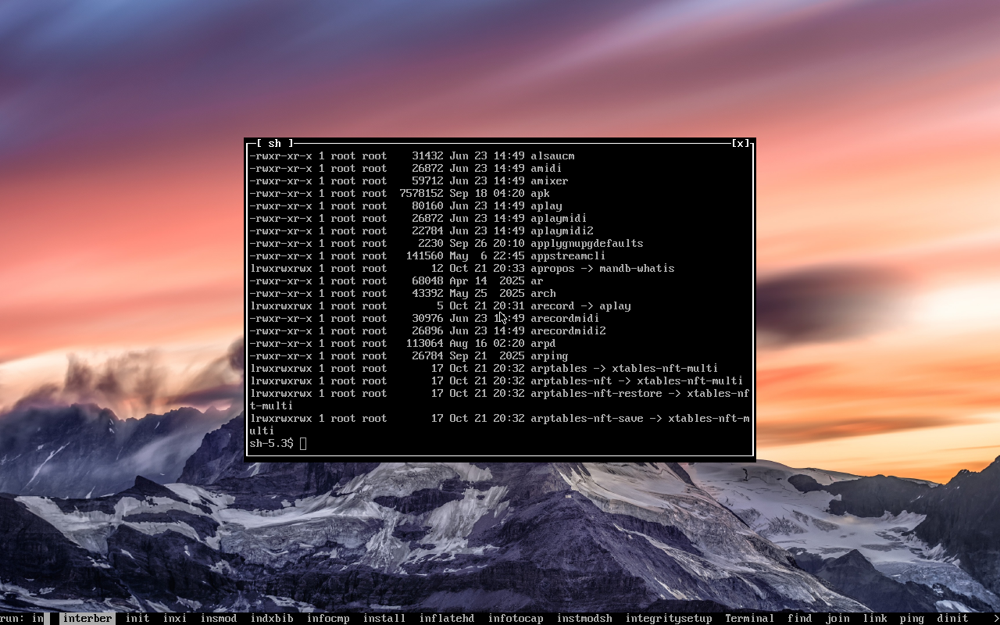

launchel, one line to type what you want to run
===============================================

A bar across the bottom of the screen, like Window Maker's run box:

	run: fir█   Firefox  firefox  firewall-config

Type, and the apps and programs that match come up next to it, the ones
you run the most first. Enter runs the highlighted one, Tab or the arrows
pick another. What you type after the name goes to it, so
"firefox chamesle.org" works.

	shift+enter     run exactly what you typed
	!htop           run it in a terminal
	ctrl+u          clear the line, ctrl+w the last word
	escape          never mind

It finds apps from their .desktop files and everything else in your PATH.
Made for [ttywm](https://github.com/tortr-rs/ttywm) but any X11 window
manager will do.

One C file, needs libX11 and libXft.

Install
-------
	make
	sudo make install

then bind it to a key. ttywm uses it for super+d.

or on Chamesle Linux:

	sudo apk add launchel

Settings
--------
~/.config/launchel/config, made the first time it starts:

	font = VGA
	font size =
	place = bottom
	terminal = ttywm-term
	text colour = grey
	background colour = black
	highlight colour = grey

What you ran is in ~/.config/launchel/history.
